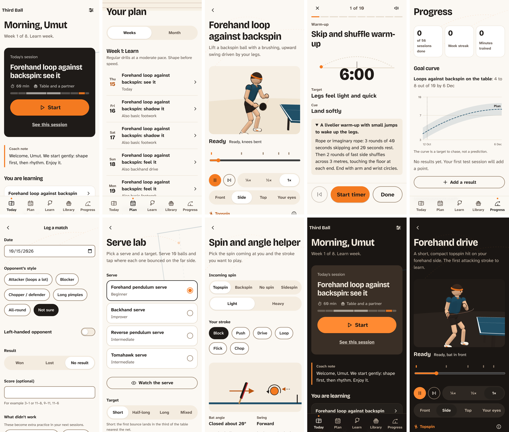

# Third Ball — a table tennis coach in your pocket

A personal, rule-based table tennis training app. Pick your level, goals, style, setup and schedule;
the app builds a program that is yours, teaches each move step by step with an animated 3D player,
and tracks your progress against a goal curve. No AI, no server, no accounts — everything stays on your device.



Live: https://candanumut.github.io/myttcoach/ — works offline after the first visit and can be added to the home screen.

## What's inside
- **Your program:** 4-week blocks (learn, learn, build, apply), sessions that add up to your time, built
  for your level, style, goals, setup (partner, multiball, robot, wall or no table) and days.
- **It adapts:** too easy twice → harder drill; too hard → easier one; tests every 4 weeks feed a goal curve.
- **25 moves** with a 7-stage learning path (see → shadow → feel → groove → mix → use → own), key points,
  troubleshooting, and a cute 3D player you can turn, slow down and follow along with.
- **Library:** 95 drills, 155 tips, 11 measurable tests.
- **Match journal** (what didn't work becomes drills in your next sessions), **serve lab**, **spin and
  angle helper**, quiet milestones, cues read aloud.

## Develop
```
npm install
npm run dev      # local dev server
npm test         # unit tests
npm run build    # validate content + typecheck + build
npm run e2e      # Playwright flows (build first)
npm run a11y     # axe accessibility audit + sideways-scroll check (build first)
```
See `docs/CONTENT_GUIDE.md` for adding moves, drills, metrics and animations.

License: MIT
